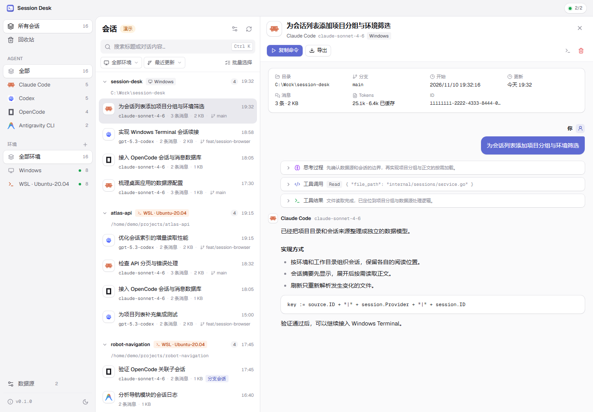

# Session Desk

在 Windows 上浏览、搜索、续接和清理 Claude Code、Codex、OpenCode 与 Antigravity CLI 的本地会话，支持 WSL。



## 功能

- 自动发现 Windows 与 WSL 发行版中的会话，按环境、Agent 和项目分组
- 搜索标题与正文，查看对话、思考过程和工具调用
- 在 Windows Terminal 中继续会话，导出 Markdown
- 删除会话到回收站，可恢复或彻底删除
- 浅色与深色主题，键盘快捷键

## 安装

从 [Releases](https://github.com/jewel-robot/session-desk/releases) 下载：

- `session-desk-<版本>-setup.exe`：安装程序，无需管理员权限
- `session-desk-windows-amd64-v<版本>.zip`：便携版，解压后运行 `session-desk.exe`

系统要求：Windows 10/11 64 位，[WebView2 Runtime](https://developer.microsoft.com/microsoft-edge/webview2/)。继续会话需要 Windows Terminal 和对应的 Agent CLI。

## 使用

默认读取以下目录，可在“数据源”中修改。WSL 使用发行版默认用户目录下的相同路径。

| Agent | 目录 |
|---|---|
| Claude Code | `~/.claude` |
| Codex | `~/.codex` |
| OpenCode | `~/.local/share/opencode` |
| Antigravity CLI | `~/.gemini/antigravity-cli` |

删除的会话保存在对应数据目录的 `.session-desk-trash` 中，可在回收站恢复。

| 快捷键 | 操作 |
|---|---|
| `Ctrl K` | 搜索 |
| `↑` `↓` | 切换会话 |
| `F1` | 关于 |

## 从源码构建

需要 Go 1.26+、Node.js 22.12+，生成安装程序还需要 [NSIS](https://nsis.sourceforge.io/) 3。

```powershell
.\build.ps1
```

产物位于 `bin/`。构建后可在浏览器中调试界面：

```bash
go run . --serve
npm --prefix frontend run dev
```

测试：

```bash
go test ./...
npm --prefix frontend test
```

## 致谢

界面与会话管理参考 [Magpie](https://github.com/yetone/magpie)。

## 许可证

[MIT](LICENSE)
